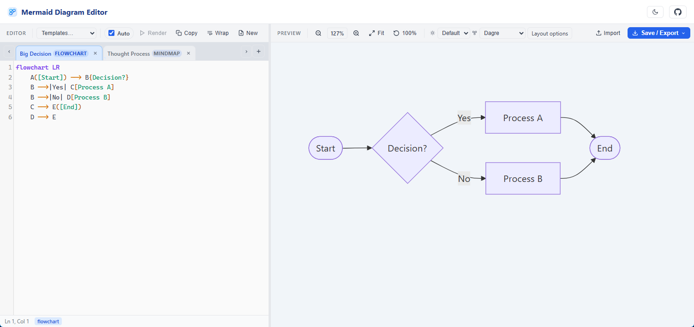

# Vibe Mermaid Diagram Editor

➡️ Try it: <a href="https://dusklight.github.io/vibe-mermaid-editor/" target="_blank" rel="noopener noreferrer">Vibe Mermaid Diagram Editor</a>

A fully client-side, zero-install browser app for creating and exporting [Mermaid](https://mermaid.js.org/) diagrams.

🤖 Initially built with Sonnet 4.6 and GPT-5.4 across ~30 chat interactions in the VS Code Copilot and Codex extensions. Subsequent updates locally with Qwen 3.8 Flash Next on Strata.



---

## Features

- **Source round-tripping** — exported files embed the original Mermaid source (PNG `tEXt` chunk, SVG `data-mermaid-source` attribute); drag an exported file back in to restore the diagram.
- **Import & export** — drag in a PNG, SVG, `.mmd`, or `.md` file; export PNG (1×, 2×, or current zoom), SVG, or preview in a new tab.
- **Multi-tab editing** — independent state, zoom, and pan per tab.
- **Live split-pane editing** — resizable editor/preview, auto-render or manual render (**Ctrl+Enter**).
- **Four layout engines** — ELK (default, bundled with Mermaid), Dagre, Tidy Tree, Cose Bilkent. Unsupported engines are grayed out; a stale choice silently falls back and flags the selector in amber.
- **ELK controls** — node placement strategy, edge merging, feedback-edge orientation, entry-node pinning, edge straightening, line hops.
- **Diagram options panel** — per-diagram switches: flowchart edge animation, mind-map coloring, packet bit order, XY-chart legend/labels, `flowchart.inheritDir`.
- **Three rendering looks** — Classic, Neo, hand-drawn (rough.js), over Mermaid's built-in themes.
- **40 built-in templates** — every diagram type supported by the loaded Mermaid version, including `usecase-beta`, `swimlane-beta`, `agentflow-beta`, `treeView-beta`, `treemap-beta`, `wardley-beta`, `cynefin-beta`, `eventmodeling`, `radar-beta`, four Railroad grammars, Ishikawa, and Venn.
- **Rich code editor** — syntax highlighting for the current Mermaid grammar, bracket matching, auto-close, find/replace, autocomplete, line-wrap toggle, status bar with inline parse errors.
- **Zoom, pan, fit** — wheel zoom, drag pan, pinch zoom, fit-to-screen (**Ctrl+Shift+F**), custom zoom input.
- **Dark/light app theme** — header toggle, independent of the diagram theme.

## Structure & architecture

No build step: native ES modules and plain JavaScript, loaded from CDN.

```
/
├── index.html        # Markup, CDN imports, UI wiring
├── css/styles.css    # All styles; design tokens in :root, overridden in body.dark
└── js/app.js         # All logic, as one async IIFE
```

Inside `app.js`, concerns are split into module-like closures with explicit public APIs:

| Closure | Responsibility |
|---|---|
| `MermaidEditorMermaidApi` | Wraps Mermaid; layout loader, per-diagram config, off-screen render host |
| `MermaidEditorTemplates` | The 40 templates and the default first-load diagram |
| `MermaidEditorExport` | PNG/SVG export & import, source embedding, CRC32 for `tEXt` chunks |
| `MermaidEditorPreview` | Render pipeline, zoom/pan state, debounced scheduling, theme switching |

The IIFE body wires these together and owns DOM interaction (tabs, toolbar, CodeMirror, shortcuts, drag-and-drop, persistence).

Styling is token-driven: colors, spacing, and component tokens are declared once in `:root` and overridden in `body.dark`, so a new color scheme only touches the declarations.

## Persistence

Tab content, active tab, app theme, and diagram theme are saved to `localStorage` automatically. Rendering options live under `mermaid-editor-layout-options` as a versioned envelope (`{ version: 2, options: { … } }`) validated key by key on load, so a schema bump or hand-edited entry falls back to defaults rather than feeding Mermaid unknown values. Each tab also stores its own layout/look/options snapshot.

## Source embedding

Implemented in `MermaidEditorExport` with no external library:

- **PNG** — a conforming `tEXt` chunk built by hand (length, type, keyword + NUL + payload, CRC-32 from a precomputed table), spliced in after `IHDR`.
- **SVG** — source UTF-8 → base64 (`btoa`), written as `data-mermaid-source` on the root `<svg>`.

Import reverses both: PNG chunks are walked for `MermaidSource`, and the SVG attribute is base64-decoded.
